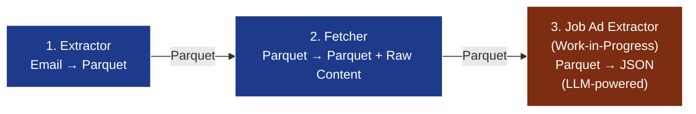
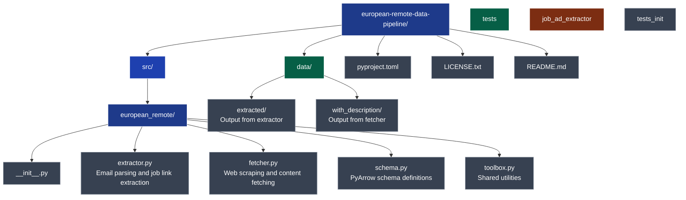

# European Remote Data Pipeline

[](https://opensource.org/licenses/MIT)
[](https://www.python.org/downloads/)

A data pipeline for extracting, fetching, and enriching [European Remote jobs](https://euremotejobs.com/) listings with LLM-powered content analysis.

## Table of Contents

- [Why, Oh Why?](why-oh-why)
- [Features](#features)
- [Architecture](#architecture)
- [Installation](#installation)
- [Usage](#usage)
  - [Extracting Job Links from Emails](#extracting-job-links-from-emails)
  - [Fetching Job Content](#fetching-job-content)
  - [Extracting Structured Data with LLM (Work-In-Progress)](#extracting-structured-data-with-llm-work-in-progress)
- [Project Structure](#project-structure)
- [Configuration](#configuration)
- [Data Schema](#data-schema)
- [Contributing](#contributing)
- [License](#license)

## Why, Oh Why??

The European Remote Jobs emails me 100 opportunities weekly. Statistically, 599 are just very specific ways of saying *not it*. As a DBRE, automation is a big part of my job. So I built this pipeline—hypocrisy should at least be efficient. It also doubles as a laboratory and learning tool while I'm on sabbatical. I will eventually succeed in automating my sabbatical away.

## Features

- **Email Parsing**: Extract job listing URLs from HTML email messages
- **Web Scraping**: Fetch raw HTML content from job posting URLs with rate limiting
- **LLM Extraction** (Work-in-Progress): Use LangChain and MistralAI to extract structured job information (work in progress)
- **Parquet Storage**: Efficient columnar storage using Apache PyArrow
- **Type Safety**: Full type hints and Pydantic validation
- **Rate Limiting**: Built-in delays to avoid overwhelming target servers
- **Error Handling**: Comprehensive error tracking and logging
- **Modular Design**: Three independent but connected processing stages

## Architecture

The pipeline consists of three main components that can be used independently or together:



1. **Extractor**: Parses email files, extracts job links, and saves to Parquet
2. **Fetcher**: Reads Parquet files, fetches raw content from URLs, saves enriched Parquet
3. **Job Ad Extractor** (Work-in-Progress): Uses LLM to extract structured job information (work in progress)

## Installation

### From Source

```console
git clone https://github.com/luismottacampos/european-remote-data-pipeline.git
cd european-remote-data-pipeline
pip install -e .
```

### Dependencies

- Python 3.14+
- beautifulsoup4 >= 4.15
- requests >= 2.34
- langchain >= 1.4
- langchain-mistralai
- python-dotenv >= 1.2.4
- markdown >= 3.11
- pyarrow >= 26.0

## Usage

### Extracting Job Links from Emails

Extract job listing URLs from RFC 5322 email files and save to Parquet:

```console
python -m european_remote.extractor --output data/extracted --verbose email.eml ...
```

### Fetching Job Content

Read Parquet files from the extractor and fetch HTML content from job URLs, saving contents, state into Parquet:

```console
python -m european_remote.fetcher --input data/extracted --output data/with_description
```

## Project Structure



## Configuration

### Environment Variables

Create a `.env` file in the project root, or set the corresponding variables in your environment:

```ini
MODEL_PROVIDER=ollama
MODEL_NAME=qwen3.8-27B
# MODEL_API_KEY=  # No key needed for local models
```

## Data Schema

The pipeline uses Apache PyArrow for efficient columnar storage. The job data schema includes:

### Core Fields

- `id`: UUID v4 (primary key)
- `url`: Job posting URL
- `url_hash`: SHA-256 hash of normalized URL
- `raw_title`: Original job title from email
- `raw_employer`: Original employer name from email
- `employer`: Cleaned employer name (extracted from raw_employer)
- `raw_content`: Raw HTML content from job URL
- `errors`: List of error messages (if any)

### LLM-Extracted Content (nested, work-in-progress)

- `content.company_name`: Company posting the job
- `content.department_name`: Department name
- `content.team_name`: Team name
- `content.date_posted`: Posting date
- `content.job_context`: Business/team/project context
- `content.compensation`: Structured compensation info
  - `pay_range`: Salary range
  - `benefits`: List of benefits
- `content.responsibilities`: List of responsibilities
- `content.qualifications`: Structured qualifications
  - `required`: Required qualifications
  - `additional`: Additional qualifications

See [src/european_remote/schema.py](src/european_remote/schema.py) for the complete schema definition.

## License

`european-remote-data-pipeline` is distributed under the terms of the [MIT License](LICENSE.txt).

Copyright (c) 2026-present Luis Motta Campos

## Support

For issues, questions, or feature requests, please open an issue on [GitHub](https://github.com/luismottacampos/european-remote-data-pipeline/issues).

Built with Python, PyArrow, LangChain, and MistralAI.
