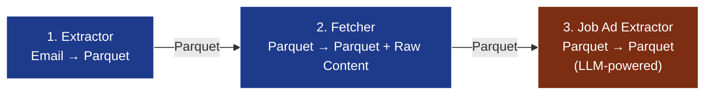
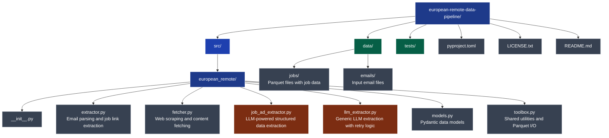

# European Remote Data Pipeline

[](https://opensource.org/licenses/MIT)
[](https://www.python.org/downloads/)

A data pipeline for extracting, fetching, and enriching [European Remote Jobs](https://euremotejobs.com/) listings with LLM-powered content analysis.

## Table of Contents

- [Why, Oh Why?](#why-oh-why)
- [Features](#features)
- [Architecture](#architecture)
- [Installation](#installation)
- [Usage](#usage)
  - [Extracting Job Links from Emails](#extracting-job-links-from-emails)
  - [Fetching Job Content](#fetching-job-content)
  - [Extracting Structured Data with LLM](#extracting-structured-data-with-llm)
- [Project Structure](#project-structure)
- [Configuration](#configuration)
- [Data Schema](#data-schema)
- [License](#license)
- [Support](#support)

## Why, Oh Why?

The European Remote Jobs emails me 100 opportunities weekly. Statistically, 599 are just very specific ways of saying *not it*. As a DBRE, automation is a big part of my job. So I built this pipeline—hypocrisy should at least be efficient. It also doubles as a laboratory and learning tool while I'm on sabbatical. I will eventually succeed in automating my sabbatical away.

## Features

- **Email Parsing**: Extract job listing URLs from HTML email messages
- **Web Scraping**: Fetch raw HTML content from job posting URLs with rate limiting
- **LLM Extraction**: Use LangChain with MistralAI or Ollama to extract structured job information from raw HTML
- **Parquet Storage**: Efficient columnar storage using Apache PyArrow
- **Type Safety**: Full type hints and Pydantic validation
- **Rate Limiting**: Built-in delays to avoid overwhelming target servers
- **Error Handling**: Comprehensive error tracking and logging with retry logic
- **Modular Design**: Three independent but connected processing stages
- **Hatch Integration**: Built-in scripts for easy execution via Hatch

## Architecture

The pipeline consists of three main components that can be used independently or together:



1. **Extractor**: Parses email files, extracts job links, and saves to Parquet
2. **Fetcher**: Reads Parquet files, fetches raw content from URLs, saves enriched Parquet
3. **Job Ad Extractor**: Uses LLM to extract structured job information and saves enriched Parquet

## Installation

### From Source

```console
git clone https://github.com/luismottacampos/european-remote-data-pipeline.git
cd european-remote-data-pipeline
pip install -e .
```

### Dependencies

- Python 3.14+
- beautifulsoup4 >= 4.15
- requests >= 2.34
- httpx
- langchain >= 1.4
- langchain-mistralai
- langchain-ollama
- python-dotenv >= 1.2.4
- markdown >= 3.11
- pyarrow >= 26.0
- pydantic

## Usage

### Extracting Job Links from Emails

Extract job listing URLs from RFC 5322 email files and save to Parquet:

```console
python -m european_remote.extractor --output data/jobs --verbose email1.eml email2.eml ...
```

**Arguments:**

- `--output, -o`: Output directory for Parquet files (default: `data/jobs`)
- `--verbose, -v`: Increment verbosity level (ERROR → WARNING → INFO → DEBUG)
- `files`: One or more email files to process

### Fetching Job Content

Read Parquet files from the extractor and fetch HTML content from job URLs, saving enriched Parquet:

```console
python -m european_remote.fetcher --input data/jobs --output data/jobs
```

**Arguments:**

- `--input, -i`: Input directory containing Parquet files from extractor (default: `data/jobs`)
- `--output, -o`: Output directory for enriched Parquet files (default: `data/jobs`)
- `--verbose, -v`: Increment verbosity level

The fetcher includes automatic rate limiting with random delays (0.5-2.0 seconds) between requests to avoid overwhelming target servers.

### Extracting Structured Data with LLM

Process jobs with raw content and extract structured information using LLM:

```console
python -m european_remote.job_ad_extractor --input data/jobs --output data/jobs
```

**Arguments:**

- `--input, -i`: Input directory containing Parquet files with raw content (default: `data/jobs`)
- `--output, -o`: Output directory for Parquet files with extracted content (default: `data/jobs`)
- `--verbose, -v`: Increment verbosity level
- `--dry-run`: Run without making changes (for testing)
- `--limit, -l`: Maximum number of records to process

**Note:** Requires environment variables to be set (see [Configuration](#configuration)).

### Using Hatch Scripts

The project includes Hatch scripts for convenient execution:

```console
# Extract job links from emails
hatch run extractor email1.eml email2.eml

# Fetch job content
hatch run fetcher

# Extract structured data with LLM
hatch run job_ad_extractor
```

## Project Structure



## Configuration

### Environment Variables

Create a `.env` file in the project root, or set the corresponding variables in your environment:

```ini
# Model provider: 'ollama' or 'mistralai'
MODEL_PROVIDER=ollama

# Model name (depends on provider)
MODEL_NAME=qwen3.8-27B

# API key (required for mistralai, not needed for local Ollama models)
# MODEL_API_KEY=your-api-key-here
```

**Supported Providers:**

- `ollama`: For local Ollama models (no API key required)
- `mistralai`: For Mistral AI cloud models (API key required)

## Data Schema

The pipeline uses Apache PyArrow for efficient columnar storage. The job data schema evolves through each stage:

### Core Fields (from Extractor)

- `id`: UUID v4 (primary key)
- `url`: Job posting URL
- `url_hash`: SHA-256 hash of normalized URL
- `raw_title`: Original job title from email
- `raw_employer`: Original employer name from email
- `employer`: Cleaned employer name (extracted from raw_employer)
- `published_at`: Publication date from email headers

### Fetcher Fields

- `raw_content`: Raw HTML content from job URL
- `fetch_status`: Status of fetch attempt (`success`, `throttled`, `gone`, `error`, `not_fetched`)
- `last_fetch_attempt`: Timestamp of last fetch attempt
- `last_fetch_status_code`: HTTP status code from last fetch
- `last_fetch_reason`: HTTP reason phrase from last fetch
- `content_length`: Size of fetched content in bytes
- `errors`: List of error messages (if any)

### LLM-Extracted Content (from Job Ad Extractor)

The `content` field contains structured job information extracted by the LLM, defined in [src/european_remote/models.py](src/european_remote/models.py):

- `content.company_name`: Company posting the job
- `content.department_name`: Department name
- `content.team_name`: Team name
- `content.date_posted`: Posting date
- `content.job_context`: Business/team/project context
- `content.compensation`: Structured compensation info
  - `pay_range`: Salary range (string or dict)
  - `benefits`: List of benefits
- `content.responsibilities`: List of responsibilities
- `content.qualifications`: Structured qualifications
  - `required`: Required qualifications
  - `additional`: Additional qualifications

Additionally:

- `extraction_status`: Status of extraction (`success`, `error`)

## License

`european-remote-data-pipeline` is distributed under the terms of the [MIT License](LICENSE.txt).

Copyright (c) 2026-present Luis Motta Campos

## Support

For issues, questions, or feature requests, please open an issue on [GitHub](https://github.com/luismottacampos/european-remote-data-pipeline/issues).

Built with Python, PyArrow, LangChain, Pydantic, MistralAI, and Ollama.
